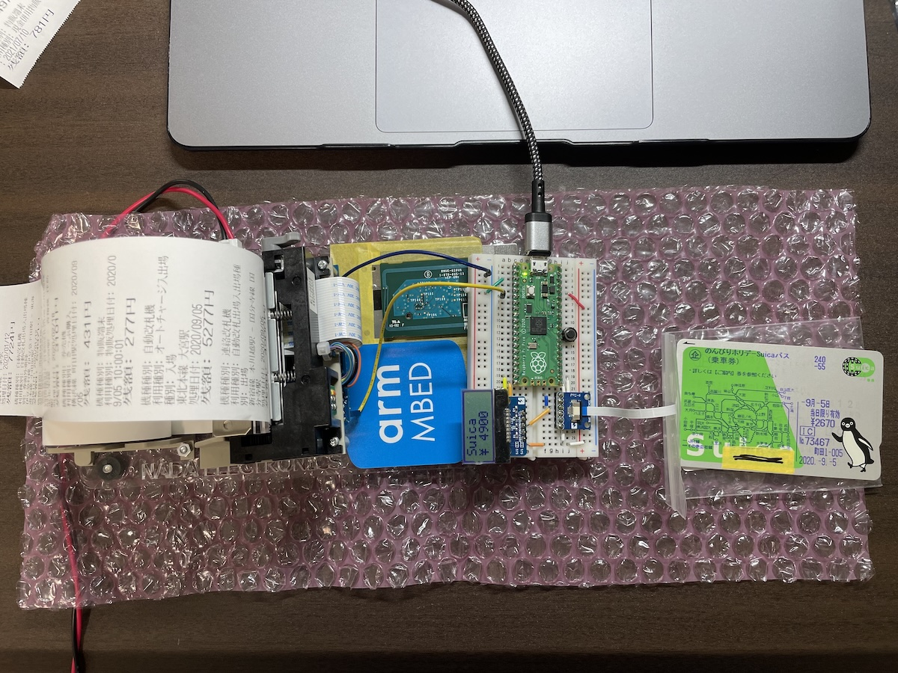

# suica-reader-rcs620s



FeliCa リーダー・ライターを使用したSuica/PASMO履歴リーダーです。

USBケーブルでRaspberry Pi Picoとパソコンを接続し、履歴データを表示させることができます。I2C接続LCDを付ければ、現在の残高を表示します。残高表示は、Suica, PASMO, SAPICA, PASPY, Edy, nanaco, WAON, ecomycaに対応しています。

また、AS-289R2プリンタシールドを接続すると、Suica/PASMO履歴データを印字することができます（[AS-289R2プリンタを使う](#as-289r2プリンタを使う)を参照）。

Raspberry Pi Picoのほかに、Pimoroni Tiny 2040とAdafruit QT Py RP2040にも対応しています（[その他のボード](#その他のボード)を参照）。

# 使用した機材

* Raspberry Pi Pico  
https://www.switch-science.com/catalog/6900/
* FeliCa リーダー・ライター RC-S620S  
https://www.switch-science.com/catalog/353/
* FeliCa RC-S620S/RC-S730 ピッチ変換基板のセット(フラットケーブル付き)  
https://www.switch-science.com/catalog/1029/
* I2C接続の小型LCD搭載ボード(3.3V版)  
https://www.switch-science.com/catalog/1405/
* AS-289R2プリンタシールド  
https://www.switch-science.com/catalog/2553/

# デバイスとの接続

Raspberry Pi Picoと他の部品は以下のように接続してください。

|Raspberry Pi Pico|RC-S620S|I2C LCD|AS-289R2|
|---|---|---|---|
|GPIO4 (pin 6)|||RxD1 (D1)|
|VSYS (pin 39)|||5V|
|3V3(OUT) (pin 36)|VDD (pin 1)|VDD (pin 2)||
|GND (pin 38)|GND (pin 4, 6)|GND (pin 3)|GND|
|GPIO16 (pin 21)|RXD (pin 2)|||
|GPIO17 (pin 22)|TXD (pin 3)|||
|GPIO14 (pin 19)||SDA (pin 4)||
|GPIO15 (pin 20)||SCL (pin 5)||
|GPIO21 (pin 27)||||

GPIO21は起動モードの切り替えに使用します（[パソコンとのUSBシリアル接続](#パソコンとのusbシリアル接続)を参照）。

AS-289R2へはデータを送信するだけなので、接続はGPIO4 → RxD1の1本で問題ありません。

## その他のボード

Pimoroni Tiny 2040とAdafruit QT Py RP2040は、以下のGPIOを使用します。

|機能|Tiny 2040|QT Py RP2040|
|---|---|---|
|RC-S620S RXD (pin 2) へ|GPIO0|GPIO28|
|RC-S620S TXD (pin 3) から|GPIO1|GPIO29|
|AS-289R2 RxD1 (D1) へ|GPIO4|非対応|
|I2C LCD SDA (pin 4)|GPIO26|GPIO24|
|I2C LCD SCL (pin 5)|GPIO27|GPIO25|
|起動モード切り替え|GPIO23 (BOOTボタン)|GPIO21 (BOOTボタン)|

電源 (3V3, VSYS/5V) とGNDの接続は、Raspberry Pi Picoと同様です。

# 必要なツールのインストール

以下のツールをインストールしてください。

* CMake (3.19以降)  
https://cmake.org/download/
* Ninja  
https://ninja-build.org/
* Arm GNU Toolchain (arm-none-eabi-gcc)  
https://developer.arm.com/downloads/-/arm-gnu-toolchain-downloads
* Python 3  
https://www.python.org/downloads/
* picotool  
https://github.com/raspberrypi/picotool

macOSでHomebrewを使用している場合は、以下のコマンドでインストールできます。

```bash
$ brew install cmake ninja python picotool
$ brew install --cask gcc-arm-embedded
```

ビルドに必要なPythonパッケージは、初回のcmake実行時に `mbed-os/venv` に自動でインストールされるため、pipで手動インストールする必要はありません。

# プログラムのビルドと書き込み

## cmake でビルドする
以下のコマンドでリポジトリをクローンして、ビルドします。

```bash
$ git clone --recursive https://github.com/toyowata/suica-reader-rcs620s
$ cd suica-reader-rcs620s
$ mkdir build && cd build/
$ cmake .. -GNinja -DMBED_TARGET=RASPBERRY_PI_PICO
$ ninja
```

ターゲット名は大文字で指定してください。Tiny 2040の場合は `-DMBED_TARGET=TINY2040`、QT Py RP2040の場合は `-DMBED_TARGET=QT_PY_RP2040` を指定します。

ビルドが成功すると、`build` ディレクトリに `suica-reader-rcs620s.uf2` が生成されます。

別のターゲットでビルドし直す場合は、`build` ディレクトリの中身を削除してからcmakeを実行してください。

## Raspberry Pi Pico に書き込む
BOOTSELモードに設定し（基板上のBOOTSELボタンを押したままUSBケーブルを接続する）、以下のいずれかの方法で書き込みます。

* picotoolで書き込む（`-x` を付けると書き込み後にプログラムを起動します）

```bash
$ picotool load -x suica-reader-rcs620s.uf2
```

* ninjaで書き込む（picotoolを使用して書き込みます）

```bash
$ ninja flash-suica-reader-rcs620s
```

* ドラッグ＆ドロップで書き込む  
パソコンに `RPI-RP2` ドライブとして認識されるので、`suica-reader-rcs620s.uf2` をドライブにコピーします。

## プログラムの実行

プログラム書き込み後、USBケーブルを抜き差しするかリセットボタンを押してプログラムを起動します。  
履歴情報をパソコンに表示する場合は、起動後すぐにGPIO21をGNDに接続し（[パソコンとのUSBシリアル接続](#パソコンとのusbシリアル接続)を参照）、TeraTerm, CoolTerm等のシリアルターミナルソフトウェアでパソコンと接続します（115200,8,N,1）。日本語を表示するので、UTF8が表示できるモードに設定してください。  
FeliCa リーダー・ライター上にSuicaを乗せると、履歴情報が表示されます。

履歴情報の例

```

*** RCS620S FeliCaリーダープログラム ***

12 07 00 00 28 2B 1D 1E 00 00 1C 25 00 00 01 00 
機種種別: 券売機
利用種別: 新規
横浜線 町田駅
処理日付: 2020/01/11
残額: 9500円

12 03 00 00 28 2B 1D 1E 00 00 90 24 00 00 02 00 
機種種別: 券売機
利用種別: きっぷ購入
横浜線 町田駅
処理日付: 2020/01/11
残額: 9360円

C7 46 00 00 28 2B A6 80 40 72 6D 23 00 00 03 00 
機種種別: 物販端末
利用種別: 物販
処理日付: 2020/01/11 20:52:00
残額: 9069円

17 01 00 25 28 2C 01 23 FF 1E 5C 0F 00 00 06 00 
機種種別: 簡易改札機
利用種別: 自動改札出場
入出場種別: 券面外乗降
東海道本線 小田原駅 - 伊豆急行線 伊豆急下田駅
処理日付: 2020/01/12
残額: 3932円

C7 46 00 00 28 2C 5C 8A BC 67 A8 0B 00 00 07 00 
機種種別: 物販端末
利用種別: 物販
処理日付: 2020/01/12 11:36:10
残額: 2984円
```

## 注意点と既知の問題

### リセット方法
リセット用のタクトスイッチを付けると便利です  
https://nuneno.cocolog-nifty.com/blog/2021/03/post-c5ccb6.html

### パソコンとのUSBシリアル接続
起動から約2秒後に起動モード切り替えピンの状態を確認し、パソコンとのUSBシリアル接続を行うかどうかを決めます。

|起動モード切り替えピン|動作|
|---|---|
|GNDに接続 (LOW)|LCDに「Waiting USB...」と表示し、パソコンのシリアルターミナルと接続されるまで待ってからスタートします。履歴情報はシリアルターミナルに表示されます。|
|未接続 (HIGH)|USBシリアル接続を行わずにスタートします。LCDでの残高表示のみ行います。|

起動モード切り替えピンは、Raspberry Pi PicoではGPIO21 (pin 27)、Tiny 2040ではGPIO23、QT Py RP2040ではGPIO21です。Tiny 2040とQT Py RP2040は、基板上のBOOTボタンを押したまま起動すると、USBシリアル接続を行います。

### AS-289R2プリンタを使う
初期設定では印字機能は無効になっています。有効にするには、`mbed_app.json5` の以下の設定を変更してから、ビルドし直してください（cmakeから実行し直す必要があります）。

変更前
```
"USE_AS289R2_PRINTER=0"
```
変更後
```
"USE_AS289R2_PRINTER=1"
```

AS-289R2は5Vで動作するため、電源はVSYS (pin 39) から供給してください。QT Py RP2040では印字機能は使用できません。

### サイバネコード
駅データのサイバネコードは、以下のサイトのデータを使用させていただきました。  
https://github.com/MasanoriYONO/StationCode

このデータから必要な項目だけを抽出し、csv形式からバイナリ形式に変更を行っています。変換用のツールは以下に公開しました。  
https://github.com/toyowata/csv2bin

### 制約事項
* 誤動作を防ぐために、同じカードを連続して読み込むことはできません。同じカードを読み込む場合は、リセットを行ってください。
